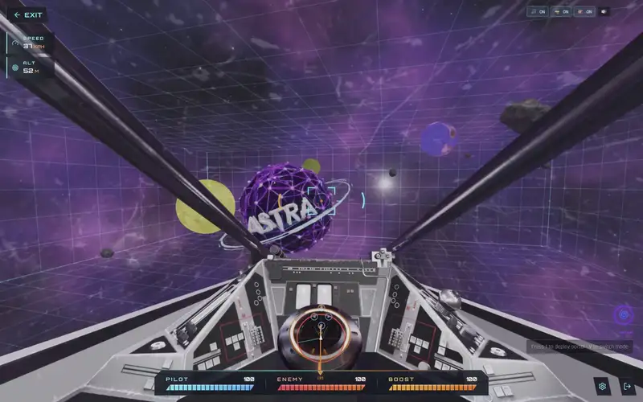

# ASTRA

A two-player 3D space dogfighter built for the browser with React, Three.js, a Node WebSocket server and PostgreSQL.

[](docs/media/astra-demo.mp4)

[Watch the 24-second gameplay demo](docs/media/astra-demo.mp4)

Fly from the cockpit, fire instant lasers, dodge with blinks, and use portals and crystal walls to change a fight. Matches run as best-of-three series with rooms, ready checks and persistent match history.

## Engineering highlights

- **US–Colombia multiplayer.** I played from the US against a friend in Colombia through a server in Virginia, at about **80 ms latency**. Local movement responds immediately while remote ships interpolate between network updates.
- **81 → about 120 FPS.** A February 2026 profiling pass on a Helios Neo 16 recorded triangles dropping from **398K to 115K**, and draw calls from **57–64 to 48**. The work included pooling target brackets, throttling radar updates, reducing per-frame allocations and simplifying geometry. These are historical results for that build and machine, rather than a benchmark of this release.
- **Separate movement and combat authority.** The client controls its own ship, sending updates at about **10 Hz**. The server runs physics at **20 Hz**, broadcasts state at **30 Hz**, and determines hits and damage. This keeps local controls responsive; trusting client positions remains a tradeoff for competitive play.
- **A complete match lifecycle.** Server-controlled loading and readiness, round transitions, a **45-second reconnect window**, disconnect forfeits and database-backed match results handle more than the flight scene.
- **Real settlement in the private version.** An earlier private implementation processed actual SOL wagers and recorded settlement receipts with combat statistics on-chain. It used server-operated custody. Wallets, wagering and settlement code are excluded from this release.

## Development

- **January–July 2025:** Started as a React space environment, explored a separate Unity multiplayer implementation, then developed the browser game's flight, rendering, networking and combat systems.
- **February 2026:** Reworked the match lifecycle, profiled rendering, added tactical abilities and reconnect handling, and integrated the private Solana settlement system.
- **November 2026:** Separated the local public demo from private services and development history, fixed release issues and tested the two-browser room-to-combat flow.

ASTRA went through multiple implementations and focused development periods. This checkout contains the browser game and local demo.

## Run locally

Requires **Node.js 24+**, Docker with Compose, and a WebGL-capable browser.

```sh
npm ci
docker compose up -d --wait
npm run demo
```

Open <http://127.0.0.1:5173/game>. Create a profile, or use the local demo account: **`astra_demo` / `AstraLocal2026!`**. Open a private browser window for a second profile. Complete or skip the tutorial, create a room in one window, join from the other, then click **Ready Up** in both.

Use **W/S** and the mouse to fly, **left click** to fire, **Shift/Space** to boost, **A/D/Q/E** to blink, **1** for a portal and **2** for a crystal wall.

With the demo running, `npm run smoke:api`, `npm run smoke:match` and `npm run smoke:settings` check the API, persisted match results and settings. Stop with Ctrl+C, then `docker compose down`.

The demo is intended for local use. Some APIs and the WebSocket layer trust client-supplied identities; do not expose this configuration directly to the public internet.

## License

Source is available under the custom [Lord Jake License](LICENSE). Asset attribution and separate terms are recorded in that file and the bundled [Draco license](public/licenses/draco.txt).
